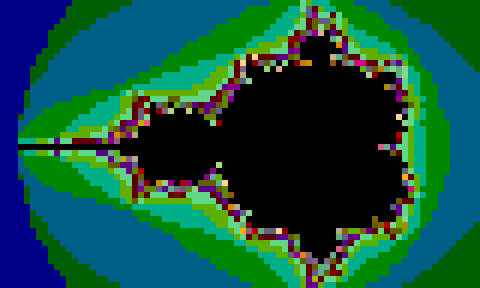

# IR4(th)

**IR4(th)** (*Typed Forth as an Intermediate Representation*) is a minimal, statically typed, monomorphic concatenative intermediate language designed for retro-computing CPUs (such as Z80 and 6502) and constrained embedded systems.

IR4(th) programs are compiled via a 2-pass direct machine-code compiler (with reachability dead-code elimination) using ir4c (written in strict C89).

IR4(th) is aimed at language builders as a compiler backend target rather than a language for writing applications directly. While it is expressive enough for hand-written tests and demos, high-level features such as structs, arrays, or records are intentionally out of scope and left to frontend languages.

See [docs/spec.md](docs/spec.md) for the full language specification and the [Lowering Guide](docs/lowering.md) for patterns targeting IR4(th) from a compiler frontend.

This project is based on [hi5](https://github.com/stefanhaustein/hi5), an earlier IR stack language prototype implemented in KMP with Z80 support.


## Examples

Hello world ([examples/hello.ir4](examples/hello.ir4)):

```forth
require "stdio.ir4"

data msg
  "Hello, world!\n" 0 :i8
end

fn main ( -> :i )
  msg type0
  0
end
```

Typed memory loop & recursion ([tests/fib.ir4](tests/fib.ir4), [lib/mem.ir4](lib/mem.ir4)):

```forth
fn fib ( n :i -> :i )
  n 2 < if n return then
  n 1 - fib n 2 - fib +
end
```

See [examples/](examples/) for more code examples and [tests/](tests/) for the full test suite.


## Compiler Optimizations

- **Dead-code elimination:** Only functions reachable from `main` and `init` blocks are emitted.
- **Constant folding & casts:** Compile-time folding for integer arithmetic/comparisons and literal casts (`:a`, `:i32`, `:u32`).
- **Strength reduction:** Power-of-2 `*`, `u/`, and `umod` by constants lower to shifts (`<<`, `u>>`) and masks (`and`); multiply/unsigned-divide by `1` is elided.
- **Immediate lowering:** Constant-operand `+`/`-`, comparisons, shifts, and base+offset memory accesses emit immediate instructions where supported by the target.
- **Static locals (Z80 / eZ80 / 6502):** Non-recursive functions place locals in static RAM rather than frame-pointer stacks.
- **On-demand runtimes:** Math, `:i32`, and floating-point helpers are embedded only when referenced.


## Building & Testing

```sh
make              # Build build/ir4c (C89)
make test         # Compile tests for Z80, 6502, ARM64 and run ARM64 JIT tests
make test-rv32    # Build QEMU virt ELF32 binaries and run them via qemu-system-riscv32 (if installed)
make test-6502    # Build sim65 binaries and run them via sim65 (if installed)
make test-z80     # Build CP/M .com binaries and run them via tnylpo (if installed)
make test-ez80    # Build Agon MOS binaries and run them via fab-agon-emulator (if installed)
```

## Usage

Compile with `ir4c`:

```sh
./build/ir4c [-t z80|ez80|6502|arm64|rv32|bc|cpm|zx81|agon|sim65|c64|x16|x16-cart|virt|obj] [-b hex_addr] [-o out.bin] [-I dir] [--platform name] [--zp hex_addr] [--stack-zp hex_addr[:init_x]] [--no-stack-zp] [--run] <input.ir4>
```

Pass `-I dir` (repeatable) to add library search directories ahead of the built-in `lib/` directory.


## Architectures & Platforms

- **6502** (-t 6502, configurable `--zp`, `--stack-zp`, `--no-stack-zp`)
  - [c64](docs/target/c64.md) (-t c64) — Commodore 64 PRG
  - sim65 (-t sim65) — cc65 simulator
  - [x16](docs/target/x16.md) (-t x16, -t x16-cart) — Commander X16 PRG and banked CRT cartridges
- **ARM64** (-t arm64) — AArch64 machine code, with `--run` JIT on macOS Apple Silicon
- **Bytecode VM** (-t bc) — IR4th bytecode, with `--run` in the built-in stack VM
- **eZ80** (-t ez80)
  - [agon](docs/target/agon.md) (-t agon) — Agon Light / Console8 24-bit ADL MOS executables
- **RISC-V RV32IM** (-t rv32)
  - obj (-t obj) — relocatable ELF32 object files (linking extern symbols and libgcc soft-float)
  - virt (-t virt) — standalone QEMU virt ELF32
- **Z80** (-t z80)
  - [cpm](docs/target/cpm.md) (-t cpm) — CP/M COM executables
  - [zx81](docs/target/zx81.md) (-t zx81) — Sinclair ZX81 `.p` snapshots


## Companion Library

IR4(th) includes a minimal companion library in [lib/](lib/). 

The companion library is included for tests and convenience and (apart from stdio) should
not be considered a core part of this project. Generally, it's aimed at test / demo
code portability rather than being a dedicated high capabilites platform abstraction.

It uses `require` with a platform → architecture → generic fallback chain (`lib/<platform>/` → `lib/<arch>/` → `lib/`).

See [docs/lib/README.md](docs/lib/README.md) for the full reference.


## Repository Layout

- [src/](src/) — Compiler frontend, code buffer, and target backends
- [lib/](lib/) — Companion library and platform overrides
- [examples/](examples/) — Standalone example programs
- [tests/](tests/) — Cross-target test suite and negative compiler tests in [tests/errors/](tests/errors/)
- [tools/](tools/) — Relocatable runtime generators and developer tools
- [docs/](docs/) — Platform documentation and screenshots

## Demo Videos

YT Playlist: https://www.youtube.com/watch?v=l4LC_M3oXqM&list=PLQKhMXcXxjVY

## Screenshots

| Target | Mandelbrot ([mandel.ir4](examples/mandel.ir4)) | TV Test Card ([testcard.ir4](examples/testcard.ir4)) |
|---|---|---|
| **Commander X16** |  |  |
| **Commodore 64** |  |  |
| **Agon** |  |  |
| **CP/M** |  | — |
| **Sinclair ZX81** |  | — |
| **Terminal (ANSI half-blocks)** |  |  |


## License

Licensed under the **GNU General Public License v3.0 or later (GPLv3+)** with a compiled-output exception and separate notices for third-party float runtimes (`math48` and `wozfp`). See [LICENSE](LICENSE) (and [GPLv3](GPLv3) for the full GPLv3 text).
