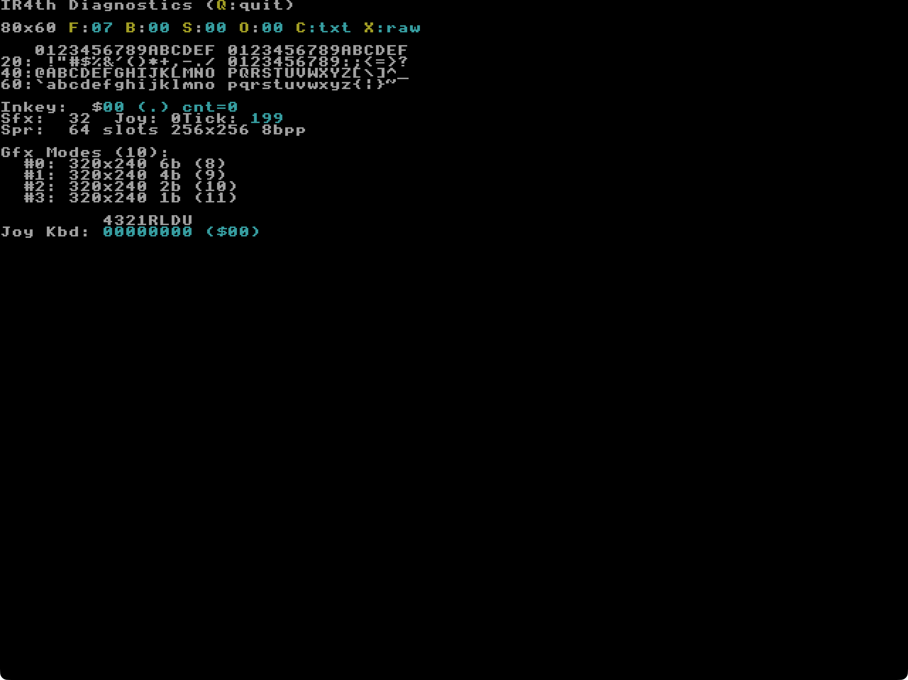
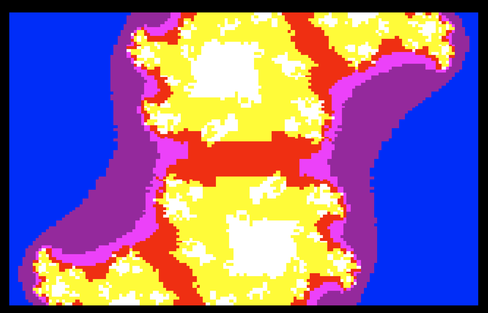
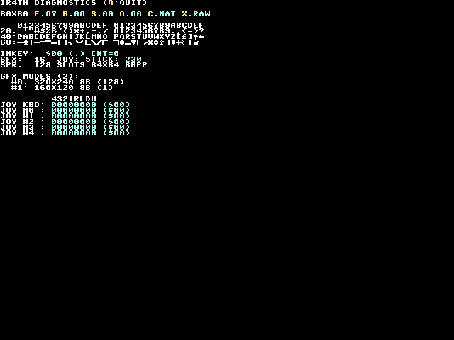
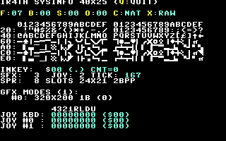
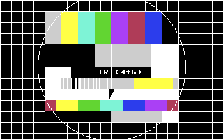
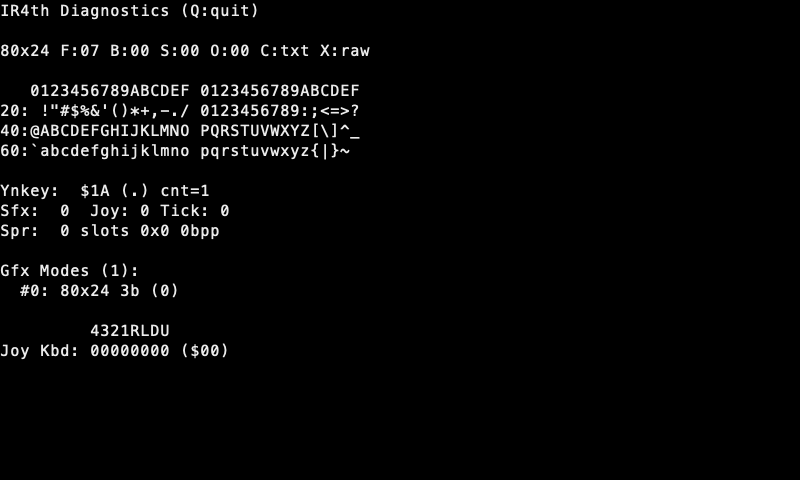
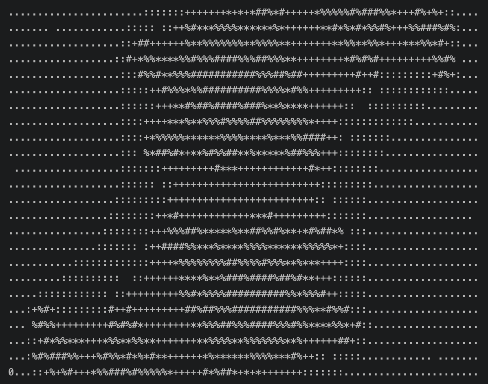
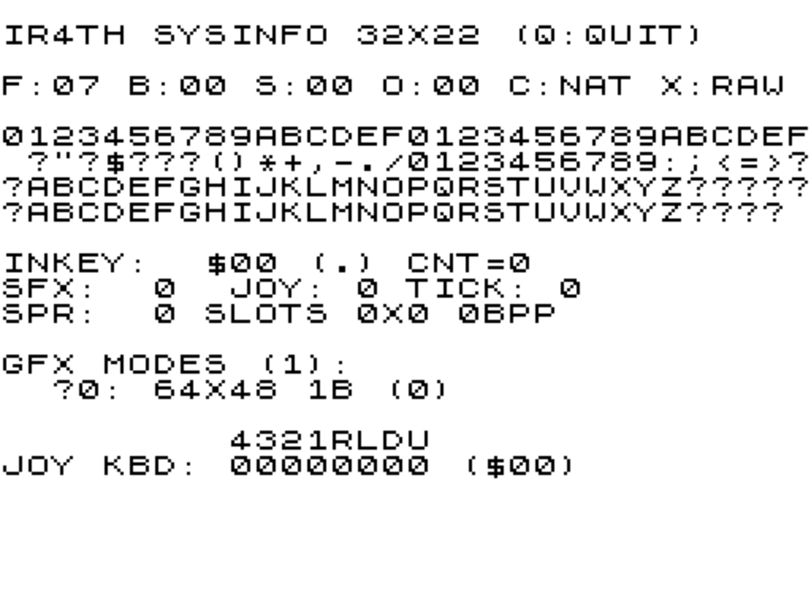
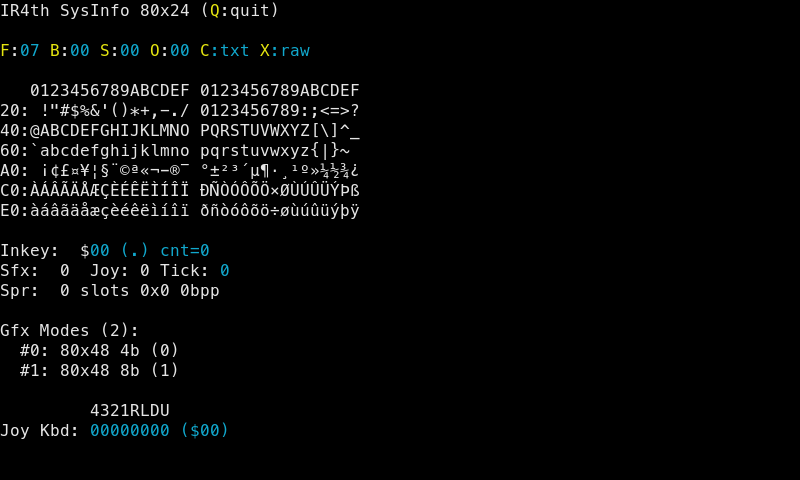
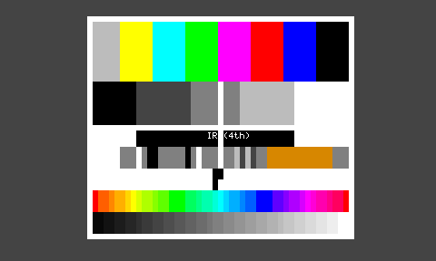

# A typed Forth Dialect as an Intermediate Representation

**IR4(th)** is a minimal, statically typed, monomorphic concatenative intermediate language designed for retro-computing CPUs and constrained embedded systems.

The architecture is structured around two tiers of retro targets:

- **8-bit execution targets (Z80, 6502):** Code generation for classic 64 KB machines (CP/M, ZX81, Commodore 64, Commander X16).
- **24-bit retro host & toolchain targets (eZ80, W65C816):** Flat 24-bit addressing for expanded retro systems (Agon Light / Console8, Commander X16GS) capable of hosting full toolchains, compilers, and IDEs directly on retro hardware.

Furthermore, IR4(th) includes native ARM64 JIT (`--run`), RISC-V (`rv32`), and a built-in bytecode VM (`bc`) for fast host-side development and verification.

IR4(th) programs are compiled via a 2-pass direct machine-code compiler (`ir4c`, written in strict C89) with reachability dead-code elimination.

IR4(th) is aimed at language builders as a compiler backend target rather than a language for writing applications directly. While it is expressive enough for hand-written tests and demos, high-level features such as structs, arrays, or records are intentionally out of scope and left to frontend languages.

See [docs/spec.md](docs/spec.md) for the full language specification and the [Lowering Guide](docs/lowering.md) for patterns targeting IR4(th) from a compiler frontend.

This project is based on [hi5](https://github.com/stefanhaustein/hi5), an earlier IR stack language prototype implemented in KMP with Z80 support motivated by [Pasta80](https://github.com/pleumann/pasta80).

## Relation to WebAssembly

IR4(th) fills a niche similar to WebAssembly (Wasm) — a statically typed, monomorphic stack-based intermediate representation — simplified to fit 8-bit and constrained retro targets:

- **Target-native widths:** Rather than mandating 32/64-bit integers, 64 KB linear-memory pages, and IEEE 754 floats, IR4(th) scales its default word (`:i`), address (`:a`), and float (`:f`) types to the target CPU (such as 16-bit or 24-bit addresses and `math48`/`wozfp` floats), with explicit `:i32` available where needed.

- **Bare-metal access vs. sandbox:** Wasm runs in a sandboxed VM with imported host APIs; IR4(th) targets bare metal with direct flat-memory loads/stores and `extern` bindings.

- **Minimal text format and direct emission:** Instead of Wasm's binary module sections, validation rules, and strictly structured control flow, IR4(th) is a simple Forth-like text IR supporting both structured blocks (`if`, `begin`/`while`/`repeat`) and unstructured jumps (`jmp`, `jz`, `jtab`). For simple projects targeting WebAssembly, it is generally recommended to emit C and compile it to Wasm rather than generating Wasm directly; IR4(th)'s simplicity makes workarounds where it is simpler to generate intermediate C unnecessary here, enabling frontends to target it directly.

## Examples

Hello world ([examples/hello.ir4](examples/hello.ir4)):

```forth
require "stdio.ir4"

data msg
  "Hello, world!\n" 0 :i8
end

fn main ( -> :i )
  msg type0
  0
end
```

Typed memory loop & recursion ([tests/test_fib.ir4](tests/test_fib.ir4), [lib/memory.ir4](lib/memory.ir4)):

```forth
fn fib ( n :i -> :i )
  n 2 < if n return then
  n 1 - fib n 2 - fib +
end
```

See [examples/](examples/) for more code examples and [tests/](tests/) for the full test suite.


## Building & Testing

```sh
make              # Build build/ir4c (C89)
make test         # Compile tests for Z80, 6502, ARM64 and run ARM64 JIT tests
make test-rv32    # Build QEMU virt ELF32 binaries and run them via qemu-system-riscv32 (if installed)
make test-6502    # Build sim65 binaries and run them via sim65 (if installed)
make test-z80     # Build CP/M .com binaries and run them via tnylpo (if installed)
make test-ez80    # Build Agon MOS binaries and run them via fab-agon-emulator (if installed)
```

## Usage

Compile with `ir4c`:

```sh
./build/ir4c [-t z80|ez80|6502|arm64|rv32|bc|cpm|zx81|agon|sim65|c64|x16|x16-cart|virt|obj] [-b hex_addr] [-o out.bin] [-I dir] [-O0|-O1] [--platform name] [--zp hex_addr] [--stack-zp hex_addr[:init_x]] [--no-stack-zp] [--run] <input.ir4>
```

Pass `-I dir` (repeatable) to add library search directories ahead of the built-in `lib/` directory.


## Architectures & Platforms

- **[6502](docs/target/6502/README.md)** (-t 6502, configurable `--zp`, `--stack-zp`, `--no-stack-zp`)
  - [c64](docs/target/c64/README.md) (-t c64) — Commodore 64 PRG
  - sim65 (-t sim65) — cc65 simulator
  - [x16](docs/target/x16/README.md) (-t x16, -t x16-cart) — Commander X16 PRG and banked CRT cartridges
- **ARM64** (-t arm64) — AArch64 machine code, with `--run` JIT on macOS Apple Silicon
- **Bytecode VM** (-t bc) — IR4(th) bytecode, with `--run` in the built-in stack VM
- **[eZ80](docs/target/ez80/README.md)** (-t ez80)
  - [agon](docs/target/agon/README.md) (-t agon) — Agon Light / Console8 24-bit ADL MOS executables
- **RISC-V RV32IM** (-t rv32)
  - obj (-t obj) — relocatable ELF32 object files (linking extern symbols and libgcc soft-float)
  - virt (-t virt) — standalone QEMU virt ELF32
- **[Z80](docs/target/z80/README.md)** (-t z80)
  - [cpm](docs/target/cpm/README.md) (-t cpm) — CP/M COM executables
  - [zx81](docs/target/zx81/README.md) (-t zx81) — Sinclair ZX81 `.p` snapshots

`ir4c` enables `-O1` optimizations by default (toggleable with `-O0`), including reachability dead-code elimination, constant folding, power-of-2 strength reduction, immediate/compare-branch lowering, and on-demand runtime embedding. These reflect the current 2-pass stack-oriented compiler rather than a limit of IR4(th) itself — the typed, monomorphic IR leaves plenty of headroom for future backends (such as register-allocating emitters).


## Frontends

- **[PASTA/84 (Pascal)](docs/frontend/pasta80/README.md)** — Classic Pascal compiler frontend targeting IR4(th) (forked from [PASTA/80](https://github.com/pleumann/pasta80)), supporting Commodore 64, Commander X16, Agon Light, CP/M, ZX81, and ARM64 JIT.


## Companion Library

IR4(th) includes a companion library resolved via `require` along a platform → architecture → generic fallback chain (`lib/<platform>/` → `lib/<arch>/` → `lib/`):

- **Core System & Runtime** ([stdio](docs/lib/stdio.md), [file](docs/lib/file.md), [system](docs/lib/system.md), [memory](docs/lib/memory.md), [string](docs/lib/string.md), [heap](docs/lib/heap.md), [math](docs/lib/math.md), [i32](docs/lib/i32.md)) — Official frontend-facing primitives covering console I/O, files, CLI args, clock, dynamic memory, and math.
- **Retro Hardware & Demo Extensions** ([terminal](docs/lib/terminal.md), [graphics](docs/lib/graphics.md), [sprite](docs/lib/sprite.md), [sound](docs/lib/sound.md), [joystick](docs/lib/joystick.md)) — Optional, minimal-footprint abstractions intended for portable tests and demos rather than a full-featured platform SDK.

See [docs/lib/README.md](docs/lib/README.md) for the full reference.


## Repository Layout

- [src/](src/) — Compiler frontend, code buffer, and target backends
- [ref/](ref/) — Unoptimized single-pass RV32IMF reference compiler in classic Pascal ([ir4p.pas](ref/ir4p.pas))
- [lib/](lib/) — Companion library and platform overrides
- [examples/](examples/) — Standalone example programs
- [tests/](tests/) — Cross-target test suite and negative compiler tests in [tests/errors/](tests/errors/)
- [tools/](tools/) — Relocatable runtime generators and developer tools
- [docs/](docs/) — Platform documentation and screenshots


## Screenshots & Videos 

[YT Playlist](https://www.youtube.com/watch?v=m7Sv4vFC7ec&list=PLQKhMXcXxjVY) (The [spheres.ir4](examples/spheres.ir4) demo works similarily on Agon and X16 and with a reduced number of spheres on C64.)

| Sysinfo ([sysinfo.ir4](examples/sysinfo.ir4)) | Julia Set ([julia.ir4](examples/julia.ir4)) | TV Test Card ([testcard.ir4](examples/testcard.ir4)) |
|---|---|---|
| **Agon** | | |
|  |  |  |
| **Commander X16** | | |
|  |  |  |
| **Commodore 64** | | |
|  |  |  |
| **CP/M** | | |
|  |  | — |
| **Sinclair ZX81** | | |
|  |  | — |
| **Terminal (ANSI half-blocks)** | | |
|  |  |  |


## License

Licensed under the **GNU General Public License v3.0 or later (GPLv3+)** with a compiled-output exception and separate notices for third-party float runtimes (`math48` and `wozfp`). See [LICENSE](LICENSE) (and [GPLv3](GPLv3) for the full GPLv3 text).
could